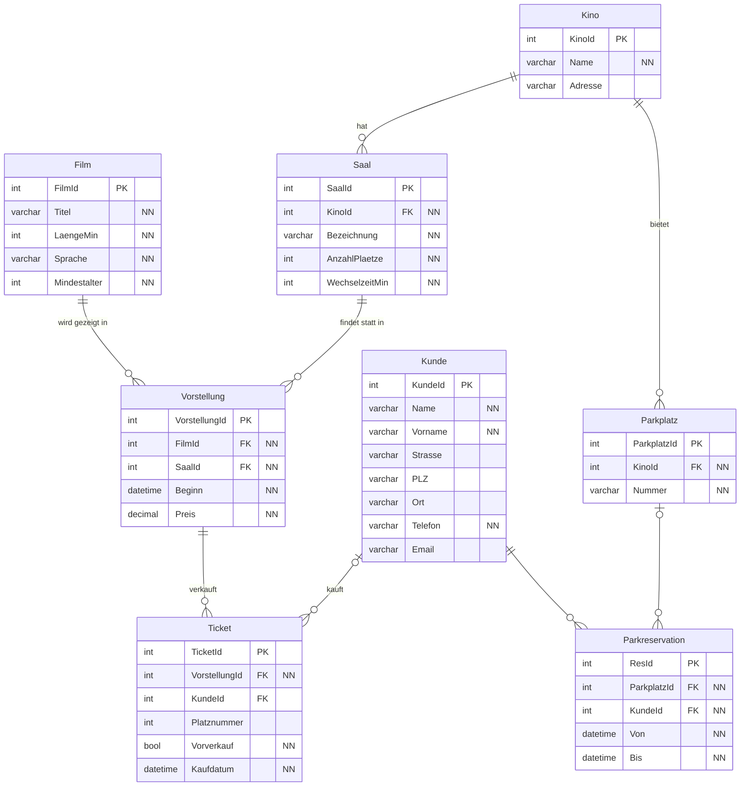

# Cineville

## Anforderungen

- Film mit Länge, Sprache, Mindestalter.
- Vorstellung = ein Film an einem Tag/Uhrzeit in einem Saal mit einem Preis (Preis gilt für alle Plätze).
- Saal mit Anzahl Plätze und Wechselzeit, gehört zu einem Kino.
- Ticket pro Vorstellung, Vorverkauf als Kennzeichen, optional einem Stammkunden zugeordnet.
- Stammkunde mit Adresse, Telefon, optional E-Mail.
- Erweiterung: Parkplätze pro Kino, die ein Kunde reservieren kann.

## ERM (3. Normalform)

3\. Normalform: Jede Tabelle beschreibt genau eine Sache, keine Wiederholungen (Film-Daten stehen nur in Film, nicht bei jeder Vorstellung), alle Nicht-Schlüssel hängen nur vom Primärschlüssel ab.

