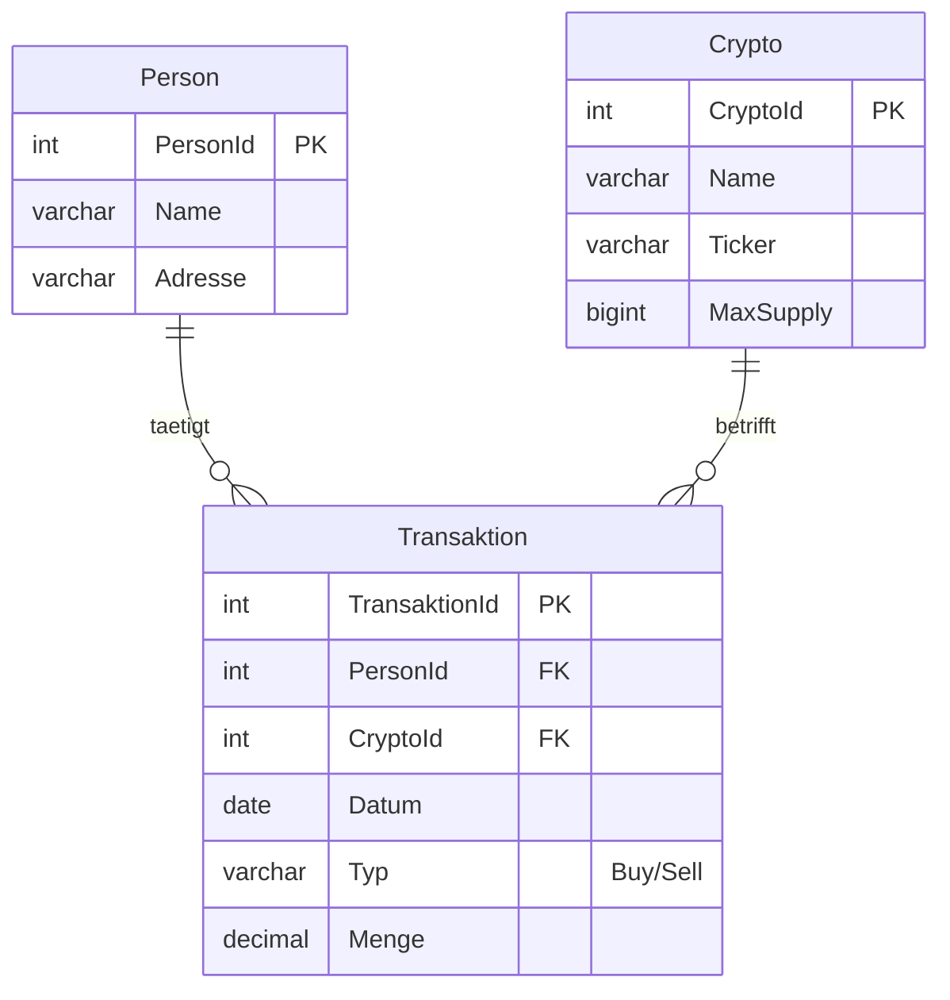
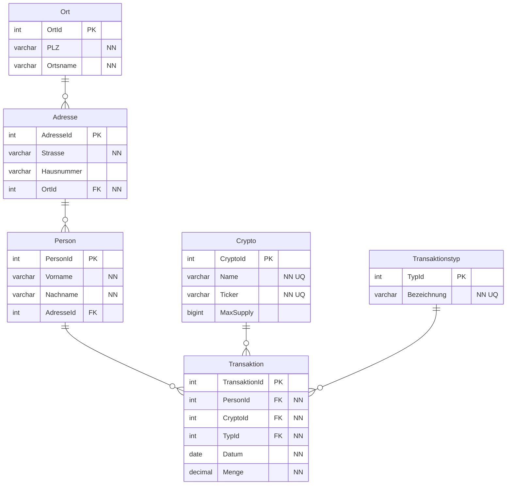

# Crypto I

## 1. Normalform (Excel)

Jede Zelle nur ein Wert: Mehrfacheinträge in Buy/Sell werden auf eigene Zeilen verteilt, Datum und Menge in zwei Spalten getrennt, Adresse in Strasse/PLZ/Ort aufgeteilt. Auszug:

| Crypto | Ticker | MaxSupply | Typ | Datum  | Menge | Name            | Strasse     | PLZ | Ort     |
|------------|------------|---------------|---------|------------|-----------|---------------------|-----------------|---------|-------------|
| Bitcoin    | BTC        | 21000000      | Buy     | 11.11.2021 | 5         | Hermelinde Weinrich | Kammerwald 51   | 76461   | Muggensturm |
| Bitcoin    | BTC        | 21000000      | Buy     | 12.12.2021 | 10        | Hermelinde Weinrich | Kammerwald 51   | 76461   | Muggensturm |
| Bitcoin    | BTC        | 21000000      | Sell    | 30.11.2021 | 4         | Hermelinde Weinrich | Kammerwald 51   | 76461   | Muggensturm |
| Etherum    | ETH        |               | Buy     | 12.11.2021 | 2         | Hermelinde Weinrich | Kammerwald 51   | 76461   | Muggensturm |
| Binance    | BNB        |               | Buy     | 06.11.2021 | 10        | Siegmund Göb        | Am Ottoturm 182 | 55270   | Essenheim   |
| Binance    | BNB        |               | Sell    | 30.11.2021 | 5         | Siegmund Göb        | Am Ottoturm 182 | 55270   | Essenheim   |
| …          |            |               |         |            |           |                     |                 |         |             |

Erkannte Fehler in den Daten: "Bitcoin" einmal mit MaxSupply 21000004, "S. Göb" = Siegmund Göb, Aleyna Schröck einmal ohne Adresse. Solche Redundanzen führen zu Anomalien.

## 2. Normalform (draw.io)

## 3. Normalform (MySQL Workbench)

