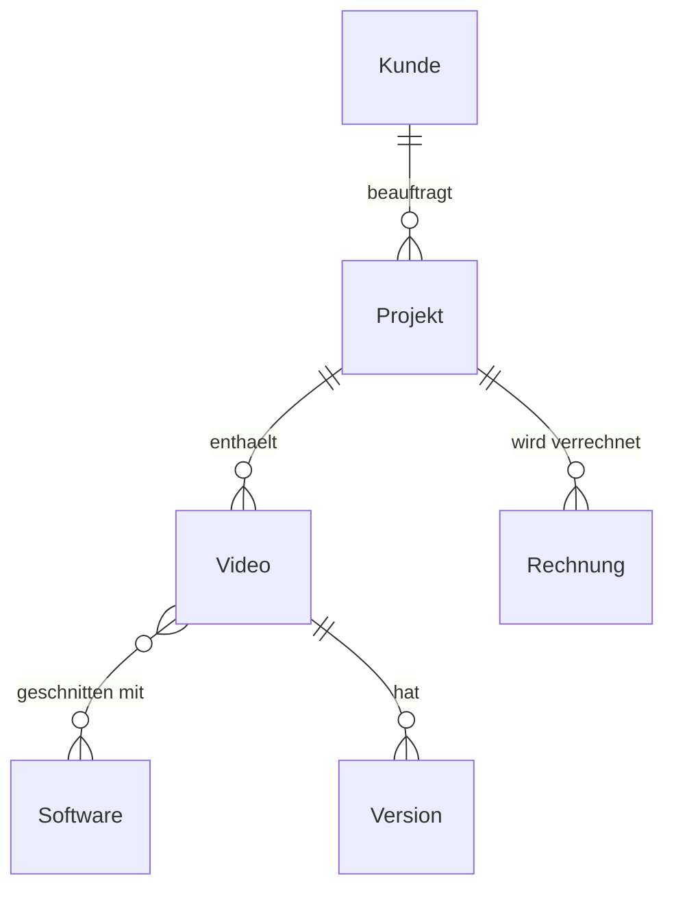
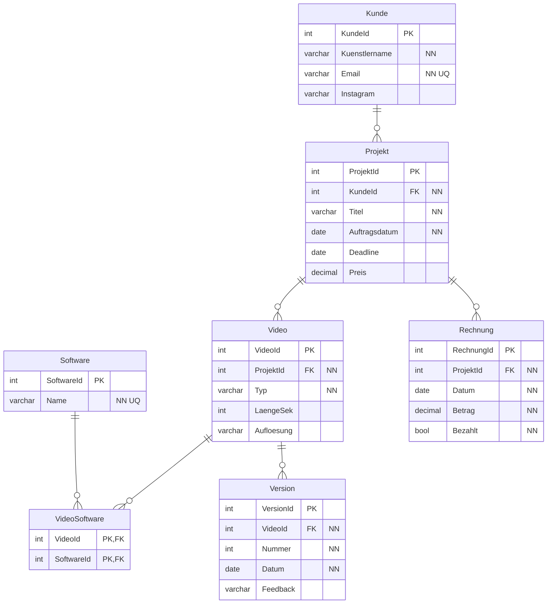

# Eigenes Projekt

## Projektbeschreibung

## Musikvideo-Produktion

Ich schneide Musikvideos und Visualizer für Künstler. Bis jetzt speichere ich Aufträge, Versionen und Rechnungen in Ordnern und Notizen.

Die Datenbank soll das festhalten:

- welcher Kunde welches Projekt bestellt hat
- welche Videos zu einem Projekt gehören
- welche Versionen es von einem Video gibt, jeweils mit Feedback
- welche Software verwendet wurde
- ob die Rechnung bezahlt ist

## Konzeptionelles ERM

## Physisches ERM

## Beschreibung der Tabellen

| Tabelle   | Inhalt                                                                    |
|---------------|-------------------------------------------------------------------------------|
| Kunde         | Künstler mit Kontaktdaten (Instagram-Handle)                                  |
| Projekt       | Ein Auftrag eines Kunden mit Deadline und Preis                               |
| Video         | Ein Video im Projekt (Musikvideo, Visualizer, Teaser) mit Länge und Auflösung |
| Version       | Jeder Export mit Datum und Kundenfeedback                                     |
| Software      | Premiere Pro, After Effects usw.                                              |
| VideoSoftware | Zwischentabelle: welches Video mit welcher Software (m:m)                     |
| Rechnung      | Rechnungen pro Projekt mit Betrag und Status                                  |

