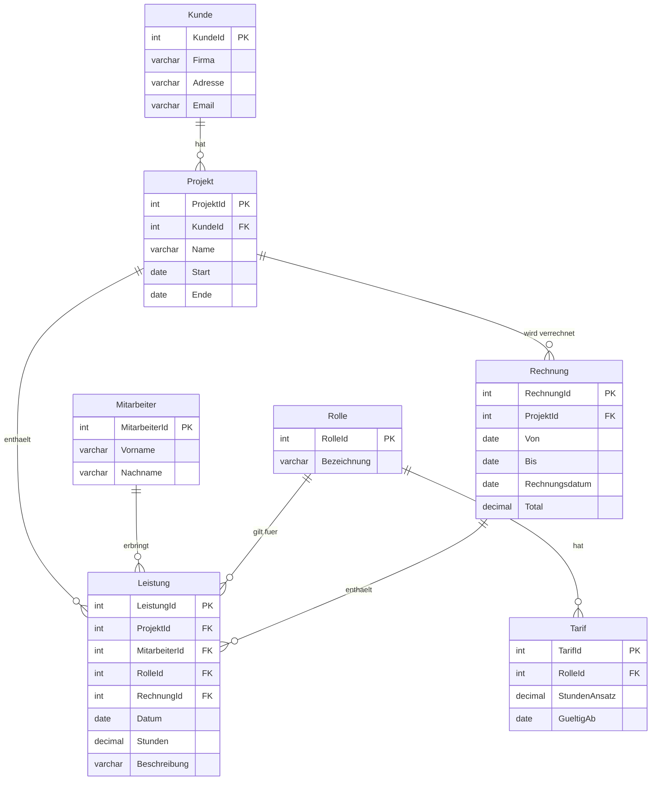

# Leistungserfassung

## Konzeptionelles Modell

## Beziehungen und Kardinalitäten

- **Kunde – Projekt (1 : mc):** Jedes Projekt gehört zu genau einem Kunden.
- **Projekt – Leistung (1 : mc):** Jede Leistung gehört zu genau einem Projekt.
- **Mitarbeiter – Leistung (1 : mc):** Jede Leistung wird von genau einem Mitarbeiter gemacht.
- **Rolle – Leistung (1 : mc):** Die Rolle wird bei jeder Leistung gespeichert. So kann Kevin einmal Projektleiter und einmal Hilfsperson sein.
- **Rolle – Tarif (1 : mc):** Jeder Tarif hat ein Datum «gültig ab». Wenn sich ein Tarif ändert, stimmen alte Rechnungen trotzdem noch.
- **Rechnung – Leistung (1 : mc):** Eine Rechnung fasst alle Leistungen aus einem Zeitraum zusammen.
