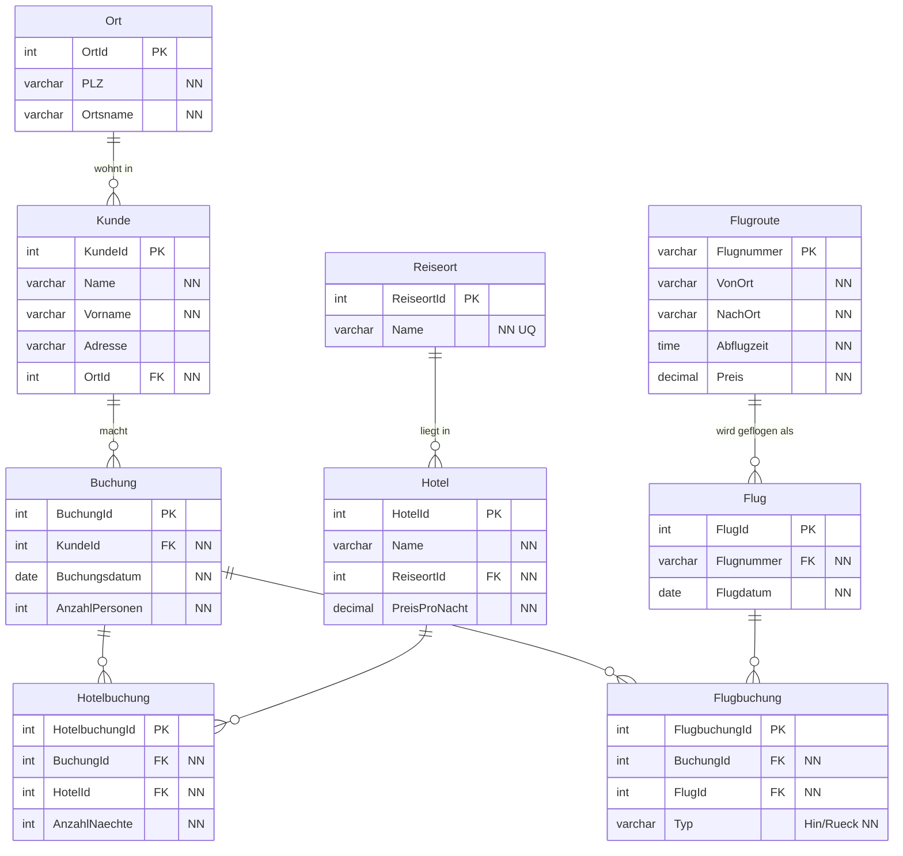

# Reisebüro

## Erkannte Redundanzen

- Kundendaten (Name, Adresse) stehen bei jeder Buchung erneut - Tippfehler wie "Jakob/Jacob Gutermann" oder "St. Gallen/St Gallen" entstehen.
- Mehrere Hotels, Reiseorte und Flüge in einer Zelle (nicht 1. Normalform).
- Flugnummer bestimmt die Route und die Abflugzeit - das steht trotzdem bei jeder Buchung.

## Physisches ERM (3. Normalform)

- Flugroute (Flugnummer, von, nach, Zeit, Preis) ist von Flug (Datum) getrennt, weil eine Route an vielen Tagen fliegt, aber nie zweimal am selben Tag.
- Hotel hat einen Preis pro Nacht, die Anzahl Nächte steht in der Hotelbuchung.
- Eine Buchung kann mehrere Hotels und mehrere Flüge enthalten (Hin/Rück).

