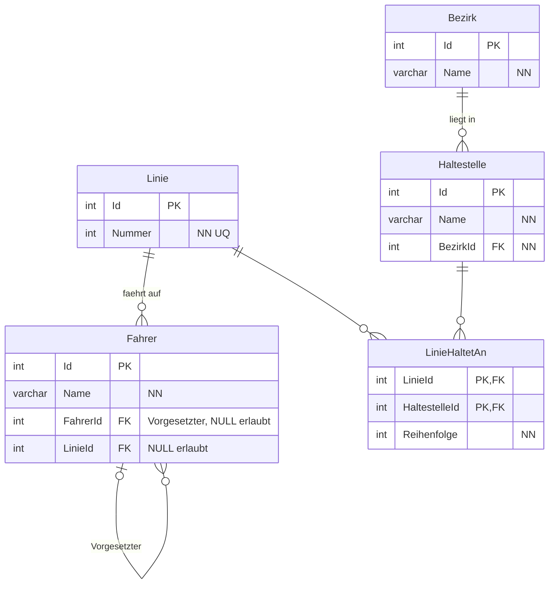

# Tramlinien

## Kardinalitäten aus den Daten

- Linie - Fahrer: 1 : mc (Alexandra hat keine Linie, Linie 203 hat zwei Fahrer).
- Fahrer - Fahrer (Vorgesetzter): c : mc (Alexandra hat keinen Vorgesetzten, 1001 ist Vorgesetzte von zwei Fahrern).
- Bezirk - Haltestelle: 1 : mc (Bezirk 5013 und 5014 haben keine Haltestelle).
- Linie - Haltestelle: mc : mc, aufgelöst durch LinieHaltetAn mit Reihenfolge.

In Workbench: FahrerId (Vorgesetzter) und LinieId bei Fahrer ohne NN, weil die Daten leere Werte enthalten. Reihenfolge, Name und Nummer NN.

