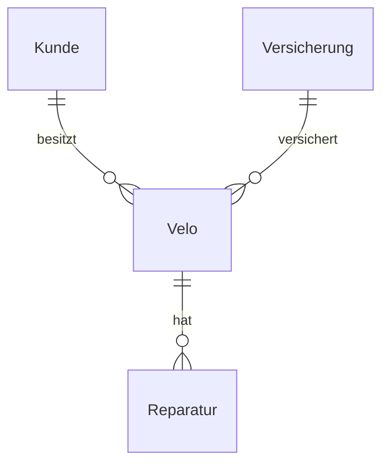
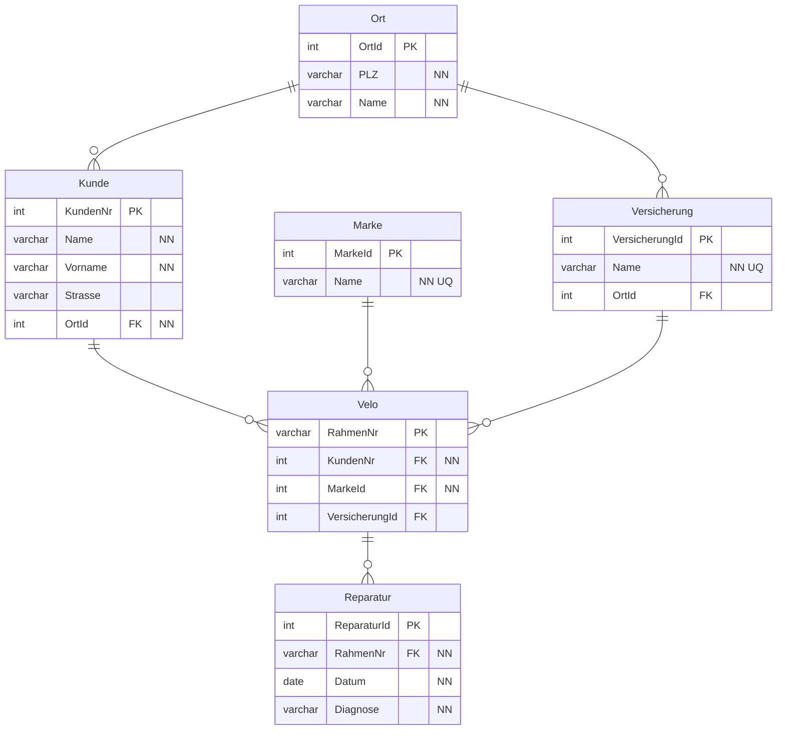

# Veloreparatur

## Anomalien in der Excel-Tabelle

- Kunde Meier steht zweimal mit allen Daten (Änderungsanomalie).
- Mehrere Velos und Reparaturen in einer Zelle.
- Bei Witzig ist nicht klar, welche Reparatur zu welchem Velo gehört.

## 1. Normalform (Excel)

| Kundennr | Name | Vorname | Strasse   | PLZ | Ort     | RahmenNr | Marke   | Versicherung | Ort Vers. | Reparaturdatum | Diagnose             |
|--------------|----------|-------------|---------------|---------|-------------|--------------|-------------|------------------|---------------|--------------------|--------------------------|
| 15           | Meier    | Hans        | Amselweg 3    | 5569    | Hasliberg   | 2394         | Dynamo      | Allianz          | St. Gallen    | 01.01.2019         | Platte                   |
| 15           | Meier    | Hans        | Amselweg 3    | 5569    | Hasliberg   | 9875         | Specialized | Allianz          | St. Gallen    | 25.02.2020         | Kettenriss               |
| 15           | Meier    | Hans        | Amselweg 3    | 5569    | Hasliberg   | 2394         | Dynamo      | Allianz          | St. Gallen    | 02.07.2006         | Beleuchtung              |
| 56           | Amstutz  | Maya        | Hauptstr. 3   | 3000    | Bern        | 1233         | Wheeler     | Zürich Vers.     | Zürich        | 01.01.2017         | Bremsscheibe eingerostet |
| 369          | Mauer    | Ueli        | Bahnhofstr. 1 | 8600    | Hinwil      | 3478         | Scott       | Helvetia         | Zürich        | 15.09.2000         | Schleicher               |
| 369          | Mauer    | Ueli        | Bahnhofstr. 1 | 8600    | Hinwil      | 3478         | Scott       | Helvetia         | Zürich        | 03.03.2002         | Platte                   |
| 369          | Mauer    | Ueli        | Bahnhofstr. 1 | 8600    | Hinwil      | 3478         | Scott       | Helvetia         | Zürich        | 29.05.2009         | Bremseinstellung         |
| 369          | Mauer    | Ueli        | Bahnhofstr. 1 | 8600    | Hinwil      | 3478         | Scott       | Helvetia         | Zürich        | 01.04.2019         | Gangschaltung            |
| 69           | Witzig   | Peter       | Am Weg 33     | 5698    | Niederzuwil | 6548         | Santa Cruz  | First Insurance  | Genf          | 05.05.2013         | Platte                   |
| 69           | Witzig   | Peter       | Am Weg 33     | 5698    | Niederzuwil | 7561         | Trek        | First Insurance  | Genf          | 09.01.2014         | Kettenriss               |
| 69           | Witzig   | Peter       | Am Weg 33     | 5698    | Niederzuwil | 4679         | Canyon      | First Insurance  | Genf          | 16.08.2015         | Lenkstange               |
| 69           | Witzig   | Peter       | Am Weg 33     | 5698    | Niederzuwil | 4679         | Canyon      | First Insurance  | Genf          | 07.10.2016         | Bremseinrostung          |

## 2. Normalform (konzeptionell)

## Logisch-physisches Design mit 3. Normalform (Workbench)

3\. Normalform: Ort (PLZ → Ort), Marke und Versicherung sind ausgelagert, weil sie nicht vom Kunden bzw. Velo abhängen. Das Velo wird über die RahmenNr identifiziert.

