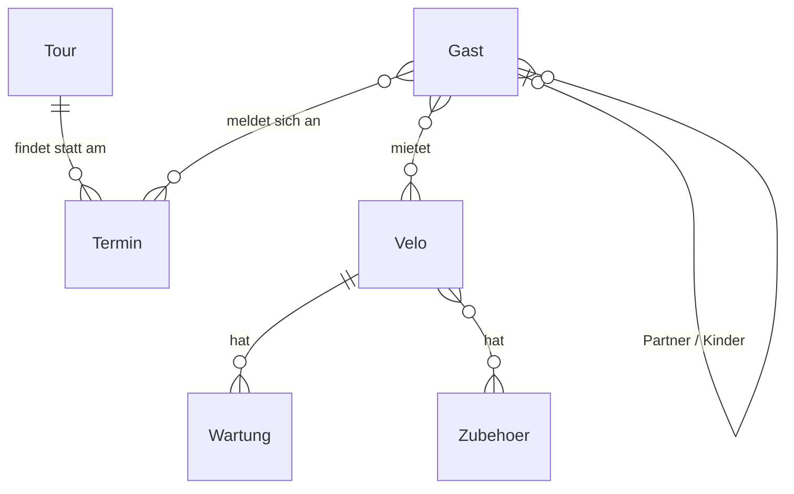
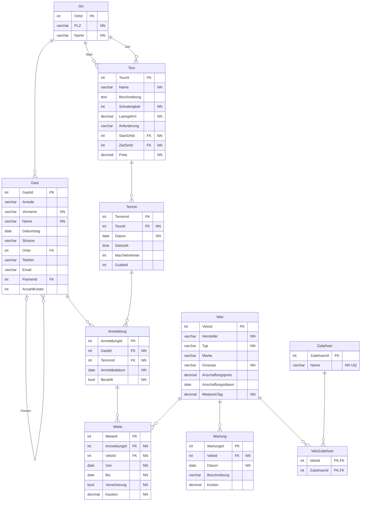

# Velotour

## Sind die Informationen ausreichend? Ergänzungen

- **Fehlt – Anmeldung:** Ein Gast meldet sich für einen Termin an, mit Status «bezahlt». Ohne Anmeldung weiss man nicht, wer mitfährt.
- **Fehlt – Infos zum Termin:** Jeder Termin braucht eine maximale Teilnehmerzahl und einen Guide.
- **Partner und Kinder:** Kein Freitext. Besser eine Beziehung Gast – Gast für den Partner und ein Feld «Anzahl Kinder».
- **Start- und Zielort:** Eine eigene Tabelle «Ort». So gibt es keine Schreibfehler.
- **Wartung und Zubehör:** Je eine eigene Tabelle, weil ein Velo mehrere Wartungen und mehrere Zubehörteile haben kann.
- **Mietvelos:** Nur Teilnehmer können ein Velo mieten. Darum gehört die Miete zur Anmeldung und nicht direkt zum Gast.
## Konzeptionelles Modell

## Physisches Modell (3. Normalform)

